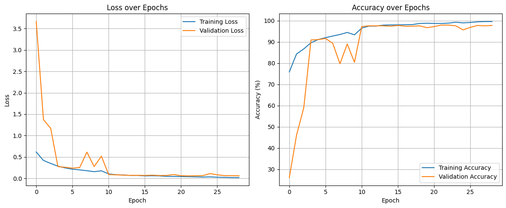
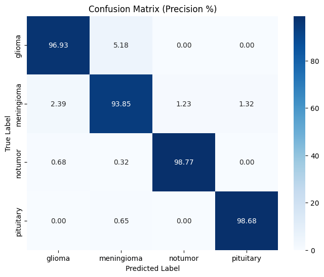
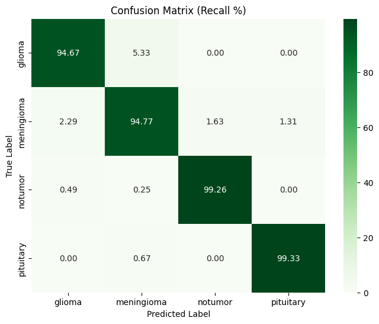
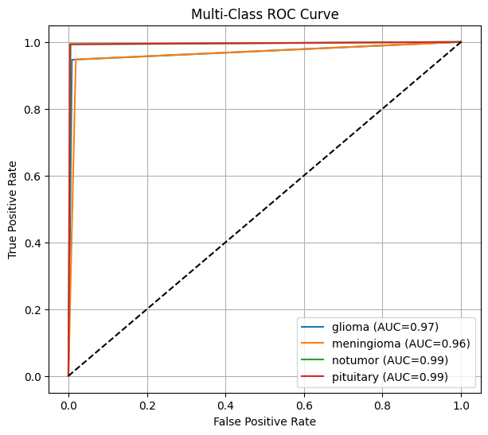
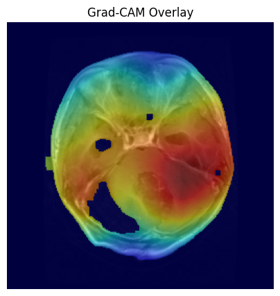
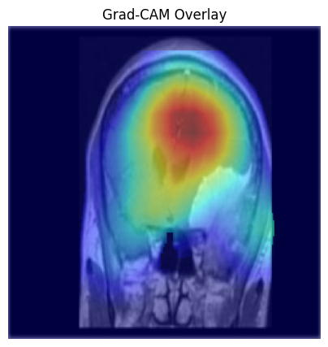
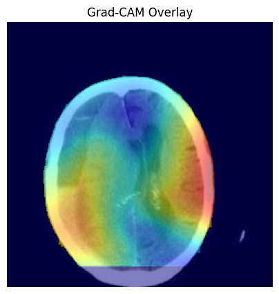
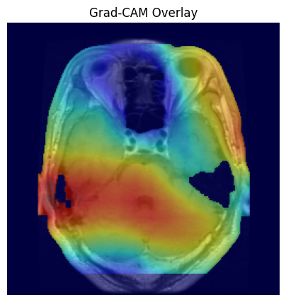
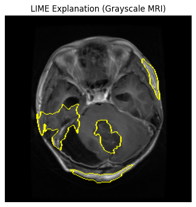
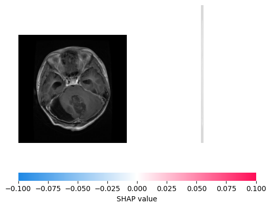

# Grad-CAM-Integrated-CNN-for-Explainable-Brain-Tumor-Classification-and-Localization
Explainable deep learning framework for brain tumor classification and localization using CNN and Grad-CAM on MRI images, achieving 97% test accuracy.
## Dataset
This project uses the Brain Tumor MRI Dataset by Masoud Nickparvar, available on Kaggle.
- **Dataset Link:** [Brain Tumor MRI Dataset](https://www.kaggle.com/datasets/masoudnickparvar/brain-tumor-mri-dataset)
- **Classes:** Glioma, Meningioma, No Tumor, and Pituitary
- **Data Type:** Brain MRI images
- **Usage:** Training and testing the CNN-based brain tumor classification model.
## Model Performance

- Overall test accuracy: 97.18%

## Training and Validation

## Confusion Matrix

## Class-wise Metrics

## ROC Curve

## Grad-CAM Explainability

### Glioma

### Meningioma

### No Tumor

### Pituitary

## LIME Explainability

## SHAP Explainability

